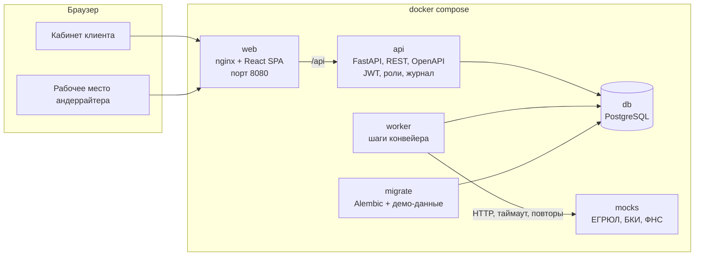

# Кредитный конвейер для малого бизнеса — прототип

Предприниматель подаёт заявку на кредит в веб-кабинете, банк обрабатывает её в том же продукте: проверка полноты → данные из ЕГРЮЛ, бюро кредитных историй и ФНС «Прозрачный бизнес» → скоринг → кредитное решение → подписание и выдача. Нестандартные заявки разбирает андеррайтер в своём рабочем месте.

Все данные синтетические, внешние сервисы — локальные моки, реальных операций нет.

## Быстрый старт (Docker)

```bash
docker compose up --build
```

- Приложение: http://localhost:8080 — на странице входа есть кнопки тестовых учёток
- Swagger: http://localhost:8080/api/docs

Требования: Docker Desktop (Windows, macOS) или Docker Engine с Compose v2, 4 ГБ свободной памяти.

## Тестовые учётки и демо-сценарий

Пароль у всех — `demo`. Каждый клиент приводит к своему исходу:

| Логин | Компания | Что сделать | Результат |
|---|---|---|---|
| `bakery` | ООО «Северная пекарня» | Кредит без залога, 2 млн ₽, 24 мес. | Автоматическое одобрение → принять → подписать → «Выдано» |
| `sokolova` | ИП Соколова (сезонный бизнес) | Кредит без залога, 2,5 млн ₽, 12 мес. | Иные условия: та же сумма на 24 мес. или 1,75 млн ₽ на 12 мес. |
| `stroy` | ООО «СтройМонтаж» | Кредит без залога, 4 млн ₽, 24 мес., выручка 50 млн ₽ | Запрос уточнений: выручка не сходится с оборотами. Исправить на 36 млн ₽ → одобрение; оставить → ручная проверка |
| `petrov` | ИП Петров | Любой кредит | Отказ: просрочка 45 дней (стоп-фактор) |
| `vector` | ООО «Вектор Логистик» | Кредит под залог, 8 млн ₽, 36 мес., склад за 12 млн ₽ | Ручная проверка: сумма выше лимита автоодобрения и массовый адрес |
| `techno` | ООО «ТехноСтарт», новый клиент | Кредит без залога, 1,5 млн ₽, без выручки | Запрос уточнений → указать выручку → бюро не отвечает → ручная проверка |
| `underwriter` | Андеррайтер | Очередь «Ручная проверка» → карточка → решение | Клиент сразу видит новое предложение |

## Как устроено



- **Статус заявки меняет только сервер.** Конечный автомат — `backend/app/domain/statuses.py`. API отдаёт `available_actions`, фронтенд рисует кнопки по этому списку.
- **Конвейер асинхронный.** Клиент отправляет заявку, API ставит задание в таблицу `jobs`, воркер выполняет шаги и ставит следующие. Фронтенд опрашивает заявку раз в 2 секунды, пока её обрабатывает банк.
- **Скоринг и решение — разные модули.** `scoring.py` даёт балл и грейд A–E (оценка риска). `decision.py` поверх грейда, продукта и проверок выбирает один из 4 исходов. Один грейд даёт разные условия для разных продуктов.
- **Сбой источника не теряет заявку.** Три попытки с паузой, затем заявка уходит андеррайтеру с пометкой «источник недоступен». Упавший шаг воркер повторяет, а после трёх неудач тоже отдаёт заявку человеку.
- **Журнал = аудит + лента клиента.** Каждый переход пишется в `application_events`: банк видит всё, клиент — свои события. Уведомления только внутри продукта, без email и SMS.

Документы: [диаграмма состояний](docs/state-diagram.md) · [модель данных](docs/data-model.md) · [OpenAPI](docs/openapi.json) · [коллекция Postman](docs/postman_collection.json)

### Бэкенд — `backend/`

```
app/
  domain/          чистая логика без БД — читать в первую очередь
    statuses.py    статусы, переходы, кто что может делать
    scoring.py     балльная карта: 11 признаков → балл и грейд
    decision.py    правила решения: стоп-факторы, лимит, иные условия, серая зона
    finance.py     аннуитет (перенесён из прототипа)
  services/        сценарии: связывают domain с БД и внешними источниками
    applications.py  действия клиента
    underwriting.py  действия андеррайтера
    pipeline.py      шаги конвейера
    assessment.py    сбор фактов о заявке для скоринга и решения
    integrations.py  HTTP-клиент к источникам: таймаут, повторы
    workflow.py      смена статуса с записью в журнал, задания, сохранение решений
    views.py         что видит клиент и что видит банк
  api/             тонкие роутеры FastAPI
  mocks/           отдельный сервис-мок ЕГРЮЛ, БКИ, ФНС
  synthetic/       продукты и демо-персоны (данные для seed и моков)
  models.py        таблицы БД
  worker.py        воркер очереди
  seed.py          демо-данные
tests/             юнит-тесты правил и сквозные сценарии через API
```

### Фронтенд — `frontend/`, Feature-Sliced Design

```
src/
  app/        роутер, защита маршрутов по ролям, провайдеры, стили
  pages/      страницы: login, client-home, new-application, client-application, bank-queue, bank-application
  widgets/    крупные блоки: шапка, прогресс заявки, «Что дальше», лента событий, оценка риска
  features/   действия: вход, создание заявки, ответ на запрос, выбор предложения, подписание, решение андеррайтера
  entities/   сущности: session, application, product, company — типы, запросы, простые UI
  shared/     api (http-клиент и типы из OpenAPI), ui-кит, форматирование, конфиг
```

Правила импорта: слой импортирует только из слоёв ниже (`pages → widgets → features → entities → shared`). Соседние слайсы одного слоя друг друга не импортируют. Из чужого слайса — только через его `index.ts`.

Типы API не пишутся руками: `src/shared/api/schema.d.ts` генерируется из OpenAPI бэкенда.

## Локальная разработка без Docker

Нужны Python 3.12+ (проверено на 3.14), Node 20+ (проверено на 24) и PostgreSQL 16.

```bash
createdb credit_conveyor && createdb credit_conveyor_test

cd backend
python3 -m venv .venv && source .venv/bin/activate   # Windows: .venv\Scripts\activate
pip install -r requirements-dev.txt
alembic upgrade head && python -m app.seed
python dev.py        # моки :8001, API :8000 (Swagger /api/docs), воркер — одной командой
pytest               # тесты, отдельная БД credit_conveyor_test

cd ../frontend
npm ci
npm run dev          # http://localhost:5173, /api проксируется на :8000
```

Сбросить демо (удалить все заявки): `python -m app.seed --reset`.

## Как вносить изменения

| Задача | Где и как |
|---|---|
| Новый признак скоринга | Функция, возвращающая `Factor`, в `domain/scoring.py` + добавить её в `FACTORS` + тест в `tests/test_scoring.py` |
| Новое правило решения | `domain/decision.py`: стоп-фактор → `stop_factors`, серая зона → `gray_zone`, требование продукта → `eligibility` |
| Новый статус или переход | `domain/statuses.py` (`TRANSITIONS`, `ACTIONS`) → `python -m app.domain.statuses` для диаграммы → подписи в `frontend/src/entities/application/model/status.ts` |
| Поле в таблице | `models.py` → `alembic revision --autogenerate -m "…"` → `alembic upgrade head` |
| Изменили API | `python -m app.export_openapi` (в `backend/`), затем `npm run api:types` (в `frontend/`) — TypeScript подсветит, что поправить |
| Новая страница | `src/pages/<имя>/ui/…Page.tsx` + `index.ts` → маршрут в `src/app/router/index.tsx` |
| Новая персона | `backend/app/synthetic/personas.py` (ИНН и ОГРН — с верными контрольными суммами, тест проверит) |

## Переменные окружения

| Переменная | По умолчанию | Назначение |
|---|---|---|
| `DATABASE_URL` | `postgresql+psycopg://localhost:5432/credit_conveyor` | Подключение к БД |
| `JWT_SECRET` | dev-значение | Секрет подписи токенов — в любом общем окружении задать свой |
| `MOCKS_URL` | `http://localhost:8001` | Адрес сервиса моков |
| `MOCKS_TIMEOUT_SEC`, `MOCKS_RETRIES` | `3`, `3` | Таймаут и число попыток к внешним источникам |
| `PIPELINE_STEP_DELAY_SEC` | `1.0` (в Docker `1.5`) | Пауза на шаге конвейера, чтобы было видно смену статусов |
| `MOCK_FAILURE_RATE` | `0` | Доля случайных сбоев моков, например `0.3` |
| `DEMO_MODE` | `true` | Показывать тестовые учётки на странице входа |

Полный список — `backend/app/config.py`, пример — `backend/.env.example`.
