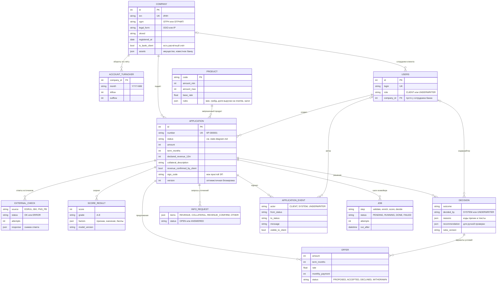

# Модель данных

Источник правды — `backend/app/models.py`, миграции — `backend/alembic/versions`. Здесь — ключевые поля и связи.

## Почему так

| Решение | Зачем |
|---|---|
| `APPLICATION_EVENT` — и аудит, и лента клиента | Одна таблица: клиент видит события с `visible_to_client`, банк — все |
| Снимки ответов в `EXTERNAL_CHECK`, версии в `SCORE_RESULT` и `DECISION` | Любое решение можно воспроизвести и объяснить |
| `JOB` — очередь в той же БД | Не нужны Redis и Kafka; воркеров можно запустить несколько (`SKIP LOCKED`) |
| `version` в `APPLICATION` | Два участника не перезапишут изменения друг друга — второй получит 409 |
| Деньги — целые рубли | Упрощение прототипа; в проде — копейки или Decimal |
