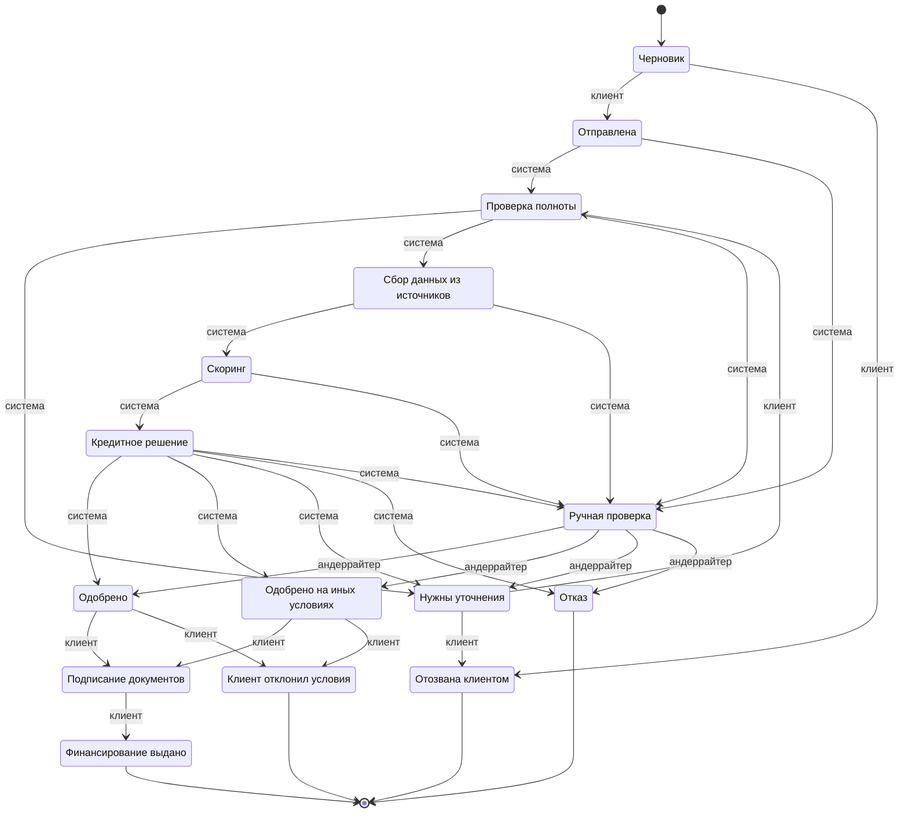

# Диаграмма состояний заявки

Сгенерирована из `backend/app/domain/statuses.py` командой `python -m app.domain.statuses` — при изменении переходов перегенерируйте.

Подпись на стрелке — кто выполняет переход: клиент, система или андеррайтер.

| Исход из кейса (стр. 15) | Статус |
|---|---|
| Одобрение | `APPROVED` |
| Одобрение на иных условиях | `COUNTER_OFFER` |
| Запрос дополнительной информации | `NEEDS_INFO` |
| Отказ | `REJECTED` |
